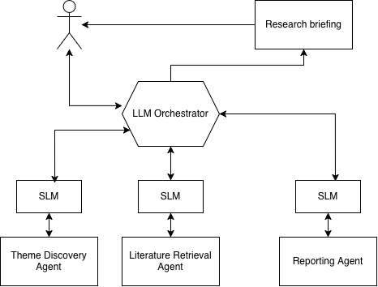

# Unit 6 Reflection
What
- Team members introduced themselves, their backgrounds, locations (especially time zones), and preferred communication platforms.

- The first meeting focused on understanding the project brief and identifying an appropriate approach, including the agent classification and architecture to use. Team members were then assigned to prepare proposals containing a problem statement and a high-level agent architecture.	

- My proposal consisted of a MAS system that helps postgraduate students to plan their thesis, transforming a broad area of interest into a focused, feasible, and academically valuable thesis topic. The proposed system should identify current research trends, discover gaps in existing literature, review academic publications, and formulate relevant research questions.

- This proposal’s main design decision was to use a Large Language Model (LLM)-based agent as a central orchestrator, coordinating multiple Small Language Model (SLM)-based agents responsible for domain-specific tasks (Farahani, Khan and Wuest, 2026). This architecture aims to reduce latency by minimizing communication overhead to a central LLM and to improve resource utilization by distributing load between the central LLM and lightweight SLMs.

- During the second meeting, we reviewed and compared the proposals, particularly those developed by Isaac and me, and selected one to move forward with. We chose the Academic Investigator system proposal.

- In the third meeting, we reviewed a draft report prepared by Ruwan, validating its technical accuracy and identifying areas for improvement.

- After several revisions to improve clarity and technical rigour, we finalized the report.

## So What

Contributing ideas and discussing alternative approaches proved to be an effective learning experience. Developing my proposal required me to analyse and critically evaluate key concepts in the agent paradigm, such as the trade-offs between a centralized LLM architecture and a hybrid architecture combining a central LLM with locally deployed SLMs. Through these discussions, I realised that although the hybrid approach was feasible, the additional coordination required between agents would make it more difficult to implement within the project scope.

Beyond the technical aspects, the experience highlighted the importance of balancing different opinions to reach consensus. Listening to and evaluating alternative viewpoints helped the team make informed decisions and improve the quality of the final solution.

I had been looking forward to this module because of my interest in agentic AI and advanced models such as Claude and GPT. As a result, I was eager to incorporate as many concepts from the module as possible, including methodologies such as GAIA, architectural styles such as Hybrid Architectures, and patterns such as the Blackboard Pattern. 

Although some of those proposals were not incorporated into the final report, I feel satisfied with my contribution to the project. e.g., the chosen system was a variation of my initial Thesis Planning Assistant, the inclusion of the agent-oriented design methodology section of the report based on the Belief-Desire-Intention model, the inclusion of an iterative development approach, etc.

However, I became frustrated when I realised that several interesting ideas had to be excluded due to time and report constraints. This experience taught me that successful software projects require balancing technical ambition with practical limitations.

## Now What

I learned about modern agent orchestration frameworks, such as LangGraph, that integrate LLMs into multi-agent systems. These frameworks use stateful graphs to coordinate agent reasoning, planning, and collaboration, providing a practical approach to implementing MAS architectures.

By discussing different architectural approaches for the multi-agent system, I expanded my understanding of large language models (LLMs). Previously, my experience had been limited to mainstream proprietary models such as Gemini, GPT, and Claude. While experimenting with their free tiers, I often encountered rate limits and latency issues, which motivated me to explore alternatives that could reduce dependence on commercial API services. As a result, I proposed minimizing LLM usage where possible and leveraging locally hosted models for tasks that did not require state-of-the-art reasoning capabilities, as local deployment can offer lower operational costs and greater control over the system.

Isaac's suggestion of using the Qwen3 model through the Hugging Face free tier proved to be an effective compromise. It provided access to a capable LLM without the usage restrictions commonly associated with the free tiers of major commercial providers. This experience broadened my perspective on the LLM ecosystem and highlighted that viable solutions extend beyond the most widely known models.

In future software engineering and AI projects, I will define project scope more carefully before exploring technical details. I will also continue using collaborative design discussions to challenge assumptions, evaluate architectural decisions, and balance innovation with practical constraints.
