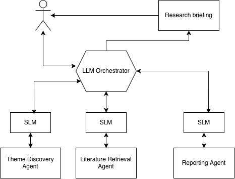

# **LLM-Powered Academic Research and Information Gathering Agent**

## **1\. Introduction**

**Problem Statement**

Postgraduate students often spend considerable time refining a broad area of interest into a focused, feasible, and academically valuable thesis topic. This process typically involves identifying current research trends, discovering gaps in existing literature, reviewing academic publications, and formulating relevant research questions.

The proposed system aims to automate and support these activities through a collection of collaborative AI agents that assist students throughout the early stages of thesis planning.

**Objective**

The objective is to develop an LLM-powered multi-agent system that can:

- Explore existing research themes within a user-selected domain.
- Identify emerging and under-researched topics.
- Generate potential research questions.
- Retrieve relevant academic literature.
- Produce a structured thesis planning report containing research recommendations and supporting evidence.

## **2\. System Requirements**

**Functional Requirements**

The system shall:

1. Accept a research topic provided in natural language.
2. Analyse the topic and generate a thesis development plan.
3. Identify dominant research themes and trends within the literature.
4. Detect potential research gaps and under-explored areas.
5. Generate candidate research questions based on identified gaps.
6. Retrieve relevant academic publications from scholarly sources.
7. Compile findings into a structured thesis planning report.
8. Allow users to download the generated report.

**Non-Functional Requirements**

The system shall provide:

- **Scalability:** Support multiple concurrent research requests.
- **Explainability:** Present clear reasoning behind recommendations and research gap identification.
- **Reliability:** Prioritize credible academic sources and references.
- **Cost Efficiency:** Minimize operational costs through the use of open-source and free-tier technologies where appropriate.
- **Extensibility:** Support future integration of additional agents, databases, and analytical capabilities.

## **3\. Proposed Multi-Agent Hybrid Architecture**

This architecture combines decentralized agents as proposed in MAS (Multi-Agent System) architectures with elements of centralized control found in traditional approaches. The idea is to achieve a system that has centralized principles and a decentralized implementation, thereby leveraging the benefits of both paradigms (Biswas and Sarkar, 2026). The Large Language Model (LLM)-based agent functions as a central orchestrator, coordinating multiple Small Language Model (SLM)-based agents responsible for domain-specific tasks (Farahani, Khan and Wuest, 2026).

**1\. Planner Agent (LLM Orchestrator)**

**Role**

The Planner Agent acts as the primary interface between the student and the system.

**Responsibilities**

- Interpret user goals and research interests.
- Decompose complex requests into subtasks.
- Coordinate communication among specialist agents.
- Aggregate outputs from all agents.
- Show the thesis planning report to the user.

**2\. Theme Discovery Agent (Edge SLM)**

**Role**

Identifies major research themes, trends, and gaps within the selected domain.

**Responsibilities**

- Query academic databases.
- Extract recurring concepts and keywords.
- Cluster related research topics.
- Analyse publication trends over time.
- Compare research activity across themes.
- Identify under-explored research areas.
- Generate candidate research questions based on detected gaps.

**3\. Literature Retrieval Agent (Edge SLM)**

**Role**

Collects supporting scholarly publications relevant to identified themes and research questions.

**Responsibilities**

- Search Semantic Scholar.
- Search Google Scholar.
- Search CrossRef.
- Retrieve publication metadata.
- Rank publications according to relevance.
- Filter duplicate or low-quality results.

**4\. Report Generation Agent (Edge SLM)**

**Role**

Creates a comprehensive thesis planning document.

**Responsibilities**

- Compile outputs from all agents.
- Summarize literature findings.
- Present research opportunities and gaps.
- Recommend thesis directions.
- Generate a structured proposal outline.

**4\. Agent Interaction Workflow**

- **Student** submits a research interest in natural language.
- The **Planner Agent** interprets the request and creates an initial workflow to accomplish the goal.
- The **Planner Agent** creates a **Shared Knowledge Space (Blackboard Pattern)** to coordinate interactions between the LLM-based Planner Agent and the specialized SLM agents.
- The **Planner Agent** selects the **Theme Discovery Agent** as the first knowledge source.
- The **Theme Discovery Agent** analyzes the research landscape to identify current trends, research gaps, and potential research questions.
- The generated research questions are published to the **Blackboard**.
- The **Planner Agent** reviews the generated research questions and selects the **Literature Retrieval Agent**.
- The **Literature Retrieval Agent** gathers relevant academic sources, supporting literature, and evidence related to the proposed research questions and stores the results in the **Blackboard**.
- The **Planner Agent** evaluates and integrates the research questions and retrieved literature available in the **Blackboard**.

**Iterative Feedback Loop**

- The **Planner Agent** assesses the quality, novelty, feasibility, and evidential support of the proposed research questions.
- If gaps, weak evidence, overlapping topics, or insufficient novelty are identified, the **Planner Agent** updates the **Blackboard** with feedback and refinement instructions.
- The **Theme Discovery Agent** revises or generates improved research questions based on the feedback.
- The **Literature Retrieval Agent** performs additional searches and retrieves supplementary evidence for the refined research questions.
- Updated results are added to the **Blackboard**, and the **Planner Agent** re-evaluates the accumulated knowledge.
- This refinement cycle continues until the research questions and supporting literature satisfy predefined quality and completeness criteria.

**Report Generation and Delivery**

- Once the research plan reaches the desired level of quality, the **Planner Agent** selects the **Report Generation Agent**.
- The **Report Generation Agent** generates a comprehensive thesis planning report, including refined research questions, supporting literature, identified research gaps, and recommended next steps.
- The generated report is stored in the **Blackboard**.
- The **Planner Agent** performs a final evaluation of the report for consistency, completeness, and relevance.
- The **Planner Agent** presents the final thesis planning report to the **Student**.

**5\. Design Decisions**

**Choice 1: Combining an LLM Orchestrator with Edge SLMs**

**Justification**

Integrating a Large Language Model (LLM) as a high-level orchestrator with Small Language Models (SLMs) deployed at edge nodes provides an effective balance between advanced reasoning capabilities and computational efficiency. This hybrid approach enables complex decision-making at the system level while maintaining responsive and resource-efficient execution at the edge.

**Benefits**

1. **Reduced Latency:** SLMs deployed on local nodes can execute specialized tasks directly at the edge, minimizing communication overhead and improving response times.
2. **Efficient Resource Utilization:** Delegating localized tasks to lightweight SLMs reduces the computational burden on the central LLM, allowing resources to be allocated more effectively.
3. **Enhanced Reasoning and Coordination:** The LLM orchestrator manages complex workflows, task allocation, and multi-step reasoning processes that require broader contextual understanding and global awareness of the system.
4. **Improved Scalability:** The distributed execution model enables the architecture to scale efficiently by adding edge nodes without significantly increasing the workload of the central orchestrator.

**Choice 2: Blackboard Pattern for Multi-Agent Coordination**

**Justification**

The Blackboard Pattern is suitable because thesis planning requires multiple specialized agents to collaboratively solve a complex problem. A shared knowledge space enables agents to contribute and refine results incrementally, while the Planner Agent coordinates the process.

**Benefits**

- **Modularity:** Each agent focuses on a specific task.
- **Decoupling:** Agents collaborate through the blackboard rather than directly.
- **Scalability:** New agents can be added with minimal changes.
- **Knowledge Sharing:** All intermediate results are centrally available.
- **Iterative Refinement:** Outputs can be continuously improved through feedback loops.
- **Traceability:** Decisions and recommendations can be traced to contributing agents.
- **Flexibility:** The Planner Agent can dynamically adapt the workflow based on the blackboard state.

**REFERENCES**

Biswas, B. and Sarkar, S. (2026) 'Responsible agentic artificial intelligence governance: Risk, safety, and ethical challenges in autonomous systems', _International Journal of Applied Resilience and Sustainability_, 2(2), pp. 142–167. Available at: <https://doi.org/10.70593/deepsci.0202005>.

Farahani, M.A., Khan, M.I. and Wuest, T. (2026) 'Hybrid Agentic AI and Multi-Agent Systems in Smart Manufacturing', _Journal of Manufacturing Systems_, 86, pp. 612–623. Available at: <https://doi.org/10.1016/j.jmsy.2026.04.002>.

Team Responsibilities

<table><thead><tr><th>
<strong>Person</strong>
</th><th>
<strong>Report responsibility</strong>
</th></tr><tr><th>
TBD
</th><th><ol><li>Planner Agent (LLM)</li></ol>
Their section of the report should contain:
<ul><li>System Design<ul><li>Describe the agent architecture and how it interacts with the other agents</li><li>Explain the technologies selected for implementation, including deployment considerations (e.g., Hugging Face Spaces)</li><li>Justify the major technical decisions made during the design process. E.g., Agent architecture.</li></ul></li><li>Agent-Oriented Design Methodology<ul><li>Explain the theoretical framework used to design intelligent agents. E.g., Belief-Desire-Intention (BDI) Model</li></ul></li><li>Challengues and Limitations<ul><li>Discuss potential difficulties and risks.</li></ul></li></ul></th></tr><tr><th>
TBD&nbsp;
</th><th><ol><li>Theme Discovery Agent</li></ol>
Their section of the report should contain:
<ul><li>System Design<ul><li>Describe the agent architecture and how it interacts with the other agents</li><li>Explain the technologies selected for implementation, including deployment considerations (e.g., Hugging Face Spaces)</li><li>Justify the major technical decisions made during the design process. E.g., Agent architecture.</li></ul></li><li>Agent-Oriented Design Methodology<ul><li>Explain the theoretical framework used to design intelligent agents. E.g., Belief-Desire-Intention (BDI) Model</li></ul></li><li>Challengues and Limitations<ul><li>Discuss potential difficulties and risks.</li></ul></li></ul></th></tr><tr><th>
TBD
</th><th><ol><li>Literature Retrieval Agent</li></ol>
Their section of the report should contain:
<ul><li>System Design<ul><li>Describe the agent architecture and how it interacts with the other agents</li><li>Explain the technologies selected for implementation, including deployment considerations (e.g., Hugging Face Spaces)</li><li>Justify the major technical decisions made during the design process. E.g., Agent architecture.</li></ul></li><li>Agent-Oriented Design Methodology<ul><li>Explain the theoretical framework used to design intelligent agents. E.g., Belief-Desire-Intention (BDI) Model</li></ul></li><li>Challengues and Limitations<ul><li>Discuss potential difficulties and risks.</li></ul></li></ul></th></tr><tr><th>
TBD
</th><th><ol><li>Report Generation Agent</li></ol>
Their section of the report should contain:
<ul><li>System Design<ul><li>Describe the agent architecture and how it interacts with the other agents</li><li>Explain the technologies selected for implementation, including deployment considerations (e.g., Hugging Face Spaces)</li><li>Justify the major technical decisions made during the design process. E.g., Agent architecture.</li></ul></li><li>Agent-Oriented Design Methodology<ul><li>Explain the theoretical framework used to design intelligent agents. E.g., Belief-Desire-Intention (BDI) Model</li></ul></li><li>Challengues and Limitations<ul><li>Discuss potential difficulties and risks.</li></ul></li></ul></th></tr></thead></table>

1000-Word Report Structure

- 1\. Introduction
  - Introduce the problem being addressed and provide context for the project.
- 2\. Requirements Analysis
  - Define what the system must do and the qualities it must possess.
- 3\. System Design
  - Describe the overall architecture and how different system components interact.
  - Explain the technologies selected for implementation.
  - Justify the major technical decisions made during the design process. E.g., Agent architecture.
- 4\. Agent-Oriented Design Methodology
  - Explain the theoretical framework used to design intelligent agents. E.g., Belief-Desire-Intention (BDI) Model
- 5\. Development Methodology.
  - Describe how the system would be developed and managed. E.g., Agile
- 6\. Challenges and Limitations
  - Discuss potential difficulties and risks.
- 7\. Conclusions
- 8\. Appendices (Excluded from word count)
  - Graphical system designs using multiple diagrams (e.g. class, sequence, activity).